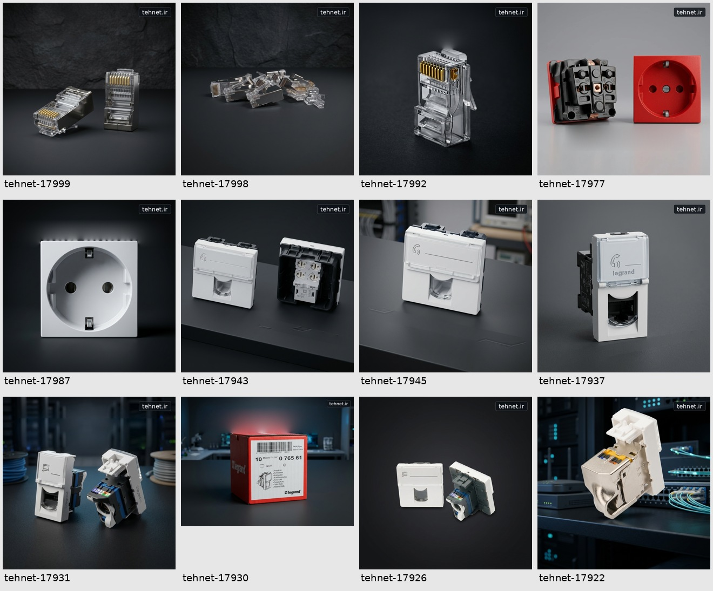
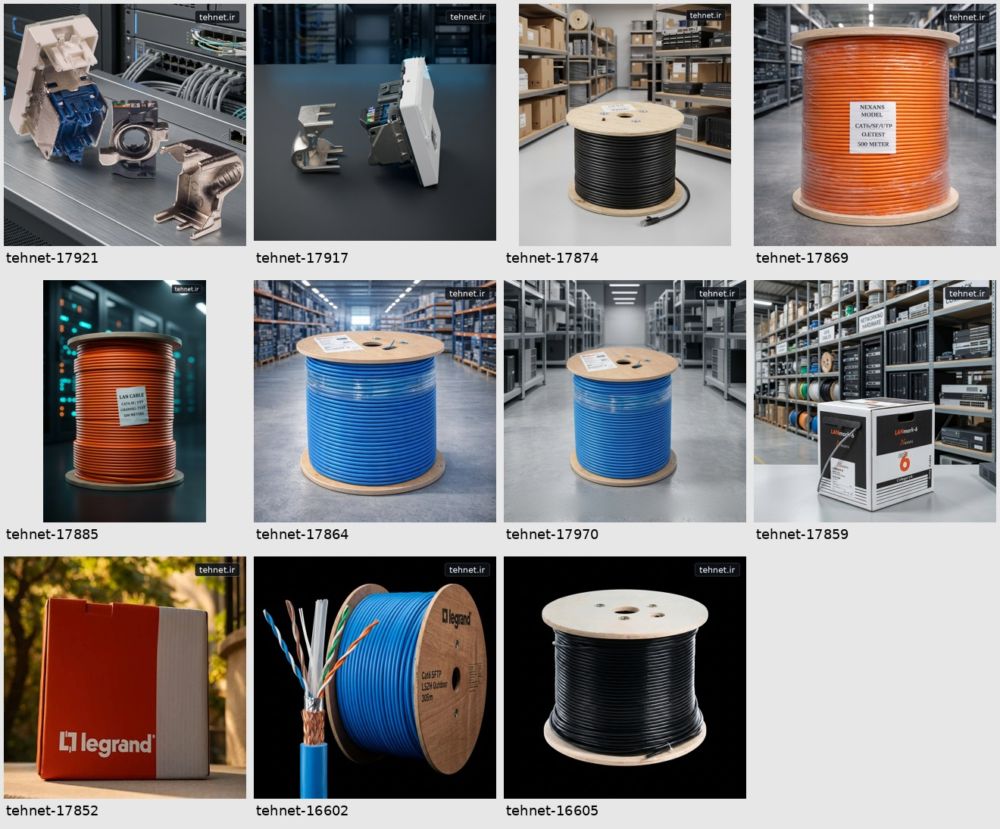

# تصاویر محصولات — tehnet.ir

مجموعهٔ ثابت تصاویر، به درخواست صریح کاربر در ۱۵ اکتبر ۲۰۲۶، در مخزن تولید محتوا ذخیره شده است. این پوشه اطلاعات runtime پنل نیست.

**۲۵ محصول، ۳۱ ارجاع تصویری، ۲۳ تصویر یکتا.** در ۱۵ تصویر ناحیهٔ نام فروشنده پاک‌سازی شد؛ روی هر ۲۳ تصویر عبارت دقیق `tehnet.ir` قرار گرفت. هشت تصویر دیگر فقط نشان جدید دریافت کردند.

## استفاده
- `masters/`: تعداد ۲۳ فایل PNG در ابعاد واقعی منبع، بدون برش یا بزرگ‌نمایی مصنوعی.
- `webp/`: تعداد ۲۳ فایل WebP برای مصرف وب.
- `catalog.md` و `products.json`: ارتباط همهٔ محصولات و تصاویر اصلی/گالری.
- `image-manifest.json` و `qa.json`: منبع، هش فایل‌ها، ابعاد و نتیجهٔ کنترل پیکسلی.

[مشاهدهٔ فهرست همهٔ محصولات](catalog.md)

## کنترل و محدودیت
در نسخهٔ PNG، تمام پیکسل‌های بیرون از ناحیهٔ ترمیم پس‌زمینه و نشان جدید بدون تغییر حفظ شده‌اند. کنترل ابعاد، بازخوانی فایل‌ها، تطبیق SHA-256 منابع و پوشش کامل ۲۵ محصول انجام می‌شود. نسخهٔ WebP فشرده‌سازی تصویری دارد.

در تصاویر 17987، 17917 و 17930 نوشتهٔ بزرگ پس‌زمینه بازسازی شده است؛ نور لبه‌ها و ترمیم پس‌زمینه قبل از انتشار بازبینی شود. ترمیم، بازیابی قطعی جزئیات پنهان‌شدهٔ عکس اصلی نیست.

این فایل‌ها برای بازبینی انسانی آماده‌اند؛ هیچ انتشار روی سایت زنده یا شبکه‌های اجتماعی انجام نشده است. نام و مشخصات سازنده از روی کالا حذف نشده و ویژگی جدیدی برای کالا ادعا نشده است. منبع برای رهگیری در manifest حفظ شده؛ تغییر نشان، مجوز مالکیت یا استفادهٔ تازه‌ای برای تصاویر ایجاد نمی‌کند.
